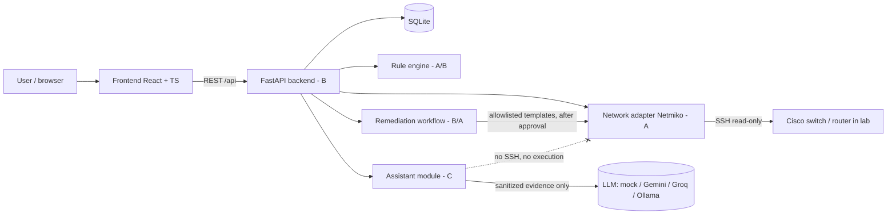

# Architecture

## Trust boundaries
1. **AI is advisory.** The assistant receives sanitized finding evidence (secrets masked, injection-like lines removed). It has no credentials and no path to the network adapter.
2. **LLM output is untrusted.** Validated against a strict schema; CLI text, unknown actions, bad parameters and fabricated evidence are rejected or stripped (`backend/app/assistant/service.py`).
3. **Changes** only via Preview → Validate → Approve → Execute → Verify, from server-side templates, with RBAC and audit log (B).
4. **Frontend is not a security boundary.** Disabled buttons are UX; the server must enforce every rule.

## Frontend structure
`src/api/client.ts` (Api interface, real + mock adapters) · `src/api/mock.ts` (in-memory mock incl. workflow rules) · `src/pages/*` · `src/components/*` · `src/types` (mirrors API schemas).

## Assistant structure
`schemas.py` (strict models, allowlist) · `sanitizer.py` · `prompts.py` · `providers.py` (mock, OpenAI-compatible) · `service.py` (pipeline) · `router.py`.
