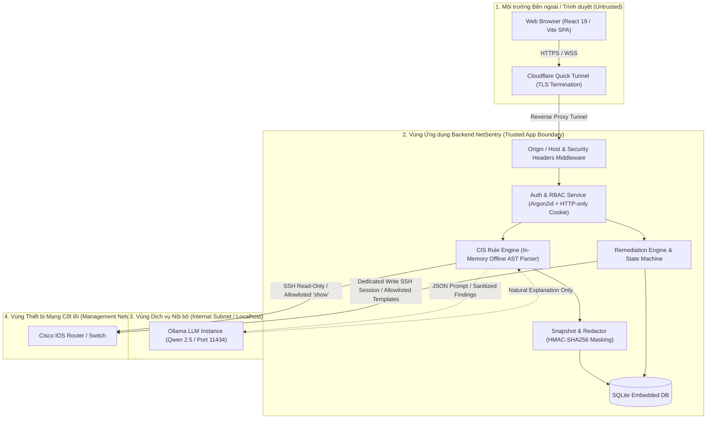
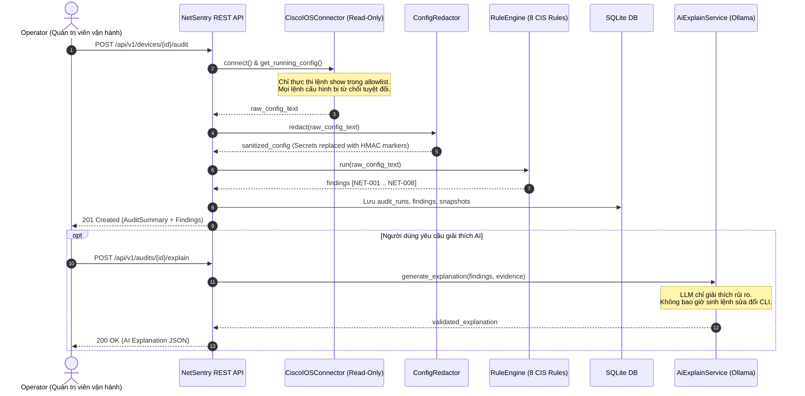
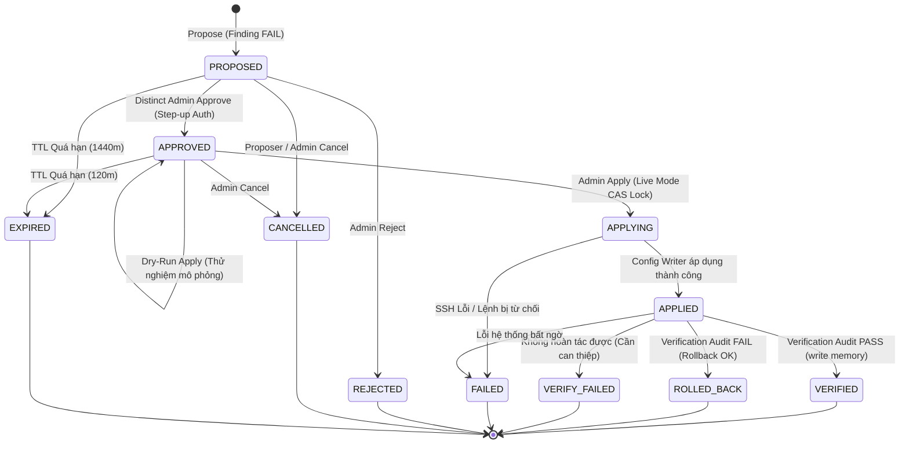
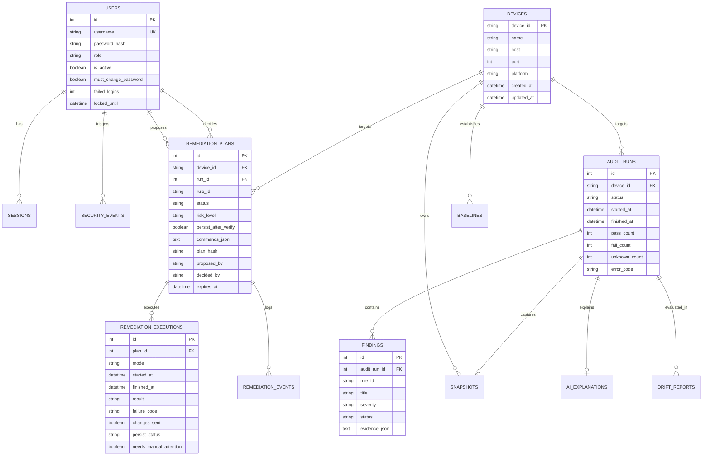

# Kiến Trúc Hệ Thống NetSentry (Architecture Overview)

Tài liệu mô tả chi tiết kiến trúc tổng thể, ranh giới tin cậy (trust boundaries), luồng tuần tự xử lý kiểm toán (Audit), luồng đề xuất và áp dụng bản vá (Remediation C/D), máy trạng thái kế hoạch sửa đổi và mô hình dữ liệu (ERD).

---

## 1. Sơ Đồ Thành Phần & Ranh Giới Tin Cậy (System Context & Trust Boundaries)

Hệ thống tuân thủ nghiêm ngặt mô hình phòng thủ theo chiều sâu (Defense-in-Depth) với 4 ranh giới bảo mật riêng biệt:



---

## 2. Luồng Tuần Tự Kiểm Toán Thiết Bị (Audit Sequence)



---

## 3. Luồng Tuần Tự Khắc Phục Lỗi Cấu Hình (Remediation Lifecycle)

NetSentry áp dụng nguyên tắc kiểm soát 4 mắt (Four-Eyes Principle / Maker-Checker): người đề xuất không được tự phê duyệt; lệnh thực thi bắt buộc khớp mẫu tĩnh đã kiểm chứng.

```mermaid
sequenceDiagram
    autonumber
    actor Proposer as Operator / Admin (Proposer)
    actor Approver as Distinct Admin (Approver)
    participant API as Remediation API
    participant Engine as RemediationService
    participant Executor as RemediationExecutor (Background Worker)
    participant Writer as CiscoIOSConfigWriter
    participant Device as Cisco IOS Router

    Proposer->>API: POST /audits/{id}/findings/{rule}/remediation
    API->>Engine: propose(rule_id, finding)
    Note over Engine: Chỉ rule hợp lệ (NET-004, NET-008) & finding FAIL.<br/>Lệnh sinh từ template tĩnh; tính plan_hash.
    Engine-->>API: Plan #1 (PROPOSED)
    API-->>Proposer: 201 Created

    Approver->>API: POST /remediation-plans/{id}/approve (Password)
    Note over Approver: Xác thực lại mật khẩu (Step-up Auth).<br/>Chặn tự duyệt nếu Proposer == Approver.
    API->>Engine: approve(plan_id, approver, password)
    Engine-->>API: Plan #1 (APPROVED)
    API-->>Approver: 200 OK

    Approver->>API: POST /remediation-plans/{id}/apply (Confirm Device + Password)
    API->>Engine: apply(plan_id, confirm_device_id)
    Note over Engine: CAS Atomic Lock trên thiết bị.<br/>Kiểm tra tính toàn vẹn plan_hash.
    Engine->>Executor: execute_async(plan_id)
    Engine-->>Approver: 202 Accepted (Execution #101 RUNNING)

    rect rgb(240, 248, 255)
        Note over Executor,Device: Tiến trình thực thi ngầm độc lập (Background Job)
        Executor->>Writer: apply(commands)
        Writer->>Device: Gửi lệnh cấu hình qua SSH phiên ghi riêng
        Executor->>API: Chạy Verification Audit độc lập
        alt Verification PASS
            Executor->>Writer: save_config() -> "write memory"
            Executor-->>API: Đánh dấu Plan VERIFIED
        else Verification FAIL
            Executor->>Writer: apply(rollback_commands, is_rollback=True)
            Executor-->>API: Đánh dấu Plan ROLLED_BACK
        end
    end
```

---

## 4. Máy Trạng Thái Kế Hoạch Khắc Phục (Plan State Machine)



---

## 5. Mô Hình Thực Thể Dữ Liệu (Entity-Relationship Diagram)


