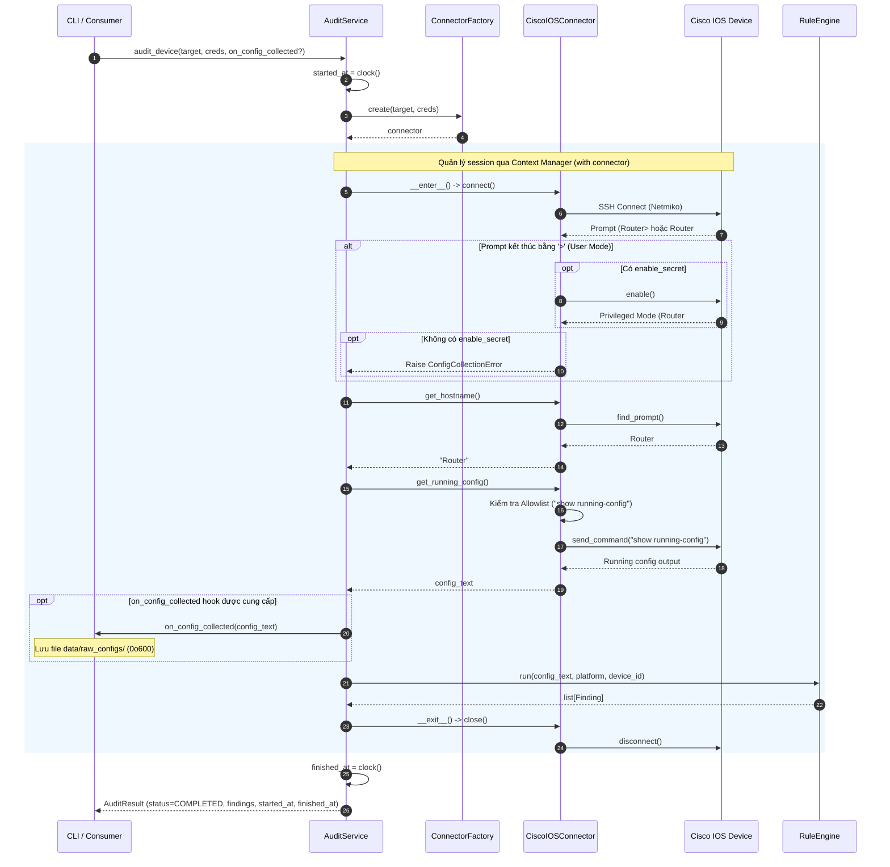

# NetSentry – Device Connector & Audit Service Flow

Tài liệu này mô tả chi tiết luồng xử lý của module **Device Connector** và **AuditService** trong NetSentry, bảng mã lỗi chuẩn hóa, hướng dẫn vận hành CLI script và các khuyến nghị an toàn thông tin.

---

## 1. Sơ đồ luồng kiểm toán thiết bị (Audit Sequence Flow)



---

## 2. Bảng ánh xạ lỗi và mã lỗi chuẩn hóa (Error Mapping)

Mọi ngoại lệ tầng hạ tầng hoặc giao tiếp mạng đều được chuẩn hóa thành các ngoại lệ thuộc cây `NetSentryError` với mã định danh không đổi:

| Tình huống phát sinh | Ngoại lệ từ Connector | Mã lỗi (`AuditResult.error_code`) | Ghi chú |
|---|---|---|---|
| Sai username / password | `AuthenticationFailedError` | `AUTH_FAILED` | Bắt từ `NetmikoAuthenticationException`, `paramiko.AuthenticationException` |
| Sai enable secret khi vào privileged mode | `AuthenticationFailedError` | `AUTH_FAILED` | Bắt từ `ValueError` khi Netmiko gọi `enable()` |
| Host không phản hồi / timeout kết nối / timeout lệnh | `ConnectionTimeoutError` | `CONNECT_TIMEOUT` | Bắt từ `NetmikoTimeoutException`, `ReadTimeout`, `TimeoutError`, `socket.timeout` |
| Từ chối kết nối SSH, rớt socket, ngắt kết nối đột ngột | `ConnectionFailedError` | `CONNECT_FAILED` | Bắt từ `paramiko.SSHException`, `OSError`, `EOFError` |
| Prompt `>` nhưng không cung cấp enable secret | `ConfigCollectionError` | `COLLECTION_FAILED` | Ngắt session ngay lập tức |
| Lệnh bị IOS từ chối (`% Invalid input`, `% Authorization failed`...) | `ConfigCollectionError` | `COLLECTION_FAILED` | Kiểm tra trên dòng output không rỗng đầu tiên |
| Output cấu hình rỗng | `ConfigCollectionError` | `COLLECTION_FAILED` | Phản hồi rỗng từ thiết bị |
| Lệnh nằm ngoài allowlist hoặc có tiền tố nguy hiểm (`conf`, `reload`...) | `CommandNotAllowedError` | `COMMAND_NOT_ALLOWED` | Chặn trước khi lệnh chạm vào thiết bị |
| Nền tảng thiết bị chưa được đăng ký trong Factory | `UnsupportedPlatformError` | `UNSUPPORTED_PLATFORM` | Ném từ `ConnectorFactory.create()` |
| Lỗi không lường trước (Unhandled Exception) | Bất kỳ Exception nào | `INTERNAL_ERROR` | Ghi log exception, ẩn chi tiết lỗi trong `AuditResult` |

---

## 3. Hướng dẫn sử dụng CLI Script (`scripts/audit_device.py`)

### 3.1. Cung cấp thông tin xác thực (Credentials)
Để bảo mật, script **không nhận mật khẩu qua tham số dòng lệnh**. Thiết lập biến môi trường trước khi chạy:

```bash
export NETSENTRY_SSH_USERNAME="cisco_admin"
export NETSENTRY_SSH_PASSWORD="MySecurePassword123!"
export NETSENTRY_ENABLE_SECRET="MyEnableSecret123!"  # (Tùy chọn nếu cần privileged mode)
```

Nếu chạy trong terminal tương tác mà chưa đặt biến môi trường, script sẽ nhắc người dùng nhập trực tiếp bằng prompt ẩn ký tự (`getpass`).

### 3.2. Cú pháp thực thi

```bash
# Kiểm toán thiết bị và in bảng kết quả (mặc định)
python scripts/audit_device.py --host 192.168.1.1 --device-id CORE-SW01

# Xuất kết quả dưới định dạng JSON (dùng cho CI/CD hoặc tích hợp pipeline)
python scripts/audit_device.py --host 192.168.1.1 --json

# Chỉ định port tùy chỉnh
python scripts/audit_device.py --host 192.168.1.1 --port 2222
```

### 3.3. Quy ước mã thoát (Exit Codes)
- **`0`**: Kiểm toán hoàn tất thành công (`status == COMPLETED`).
- **`1`**: Lỗi tham số dòng lệnh, thiếu thông tin xác thực hoặc đường dẫn `--dump-config` không hợp lệ.
- **`2`**: Kiểm toán thất bại do lỗi kết nối / xác thực / thu thập cấu hình (`status == FAILED`).

---

## 4. Cảnh báo và Hướng dẫn về `--dump-config`

> [!WARNING]
> **CẢNH BÁO BẢO MẬT: NGUY CƠ RÒ RỈ BÍ MẬT HỆ THỐNG**
> File `running-config` thô từ thiết bị mạng có thể chứa mật khẩu dạng băm yếu (Type 7), khóa pre-shared key VPN, SNMP community strings hoặc topology mạng nội bộ.
> **TUYỆT ĐỐI KHÔNG commit các file này vào kho lưu trữ mã nguồn Git.**

- **Vị trí lưu trữ**: Tùy chọn `--dump-config` **bắt buộc** chỉ được ghi vào thư mục con bên trong `data/raw_configs/`. Bất kỳ nỗ lực path traversal (ví dụ `../../etc/passwd` hoặc ghi ra `/tmp`) sẽ bị từ chối với mã thoát `1`.
- **Phân quyền tập tin**: File được tạo tự động với quyền `0o600` (chỉ cho phép user hiện tại đọc và ghi) trên các hệ điều hành tương thích POSIX.
- **Cách dùng**:
  ```bash
  python scripts/audit_device.py --host 192.168.1.1 --device-id R1 --dump-config data/raw_configs/R1.cfg
  ```
