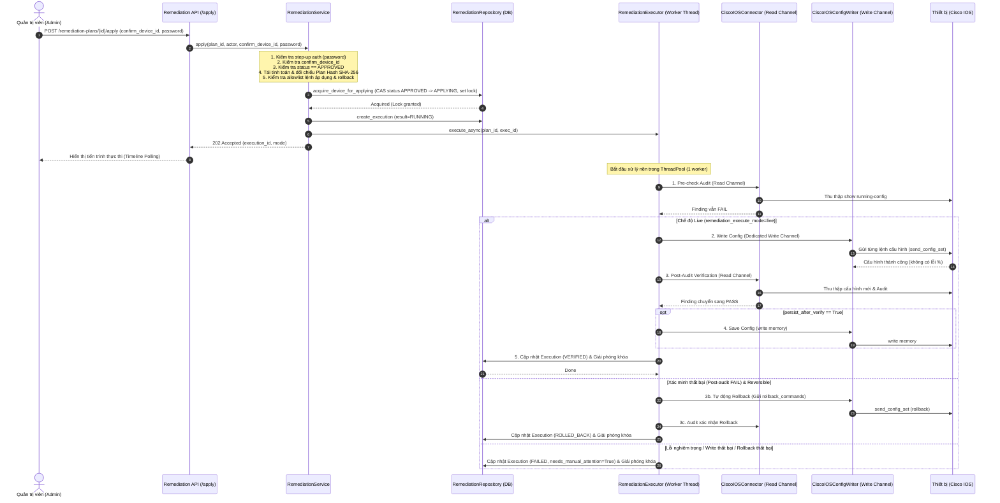
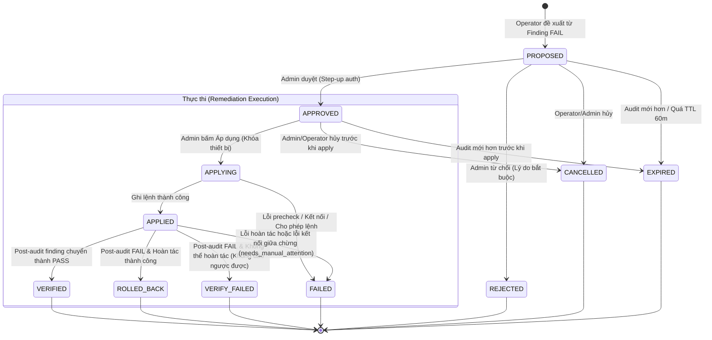

# NetSentry Remediation Execution Specification & Operations Guide

Tài liệu này mô tả chi tiết kiến trúc, mô hình bảo mật, luồng thực thi và quy trình vận hành của tính năng **Tự động thực thi kế hoạch khắc phục (Remediation Execution)** trên NetSentry.

---

## 1. Tổng quan & Triết lý Thiết kế

Hệ thống khắc phục sự cố tự động của NetSentry được thiết kế tuân thủ các nguyên tắc an toàn nghiêm ngặt dành cho môi trường mạng doanh nghiệp:

1. **AI Tuyệt đối Không Sinh Lệnh Trực Tiếp**: Mọi lệnh cấu hình và lệnh hoàn tác đều được định nghĩa cứng trong mã nguồn (mẫu cố định đã được kiểm duyệt), có tham số hóa chặt chẽ và qua kiểm tra allowlist regex nghiêm ngặt.
2. **Phân Tách Kênh Đọc và Kênh Ghi (Dual Channel Isolation)**:
   - Kênh đọc (`CiscoIOSConnector`): Sử dụng tài khoản chỉ có quyền xem (`show`), từ chối tuyệt đối mọi lệnh cấu hình (`conf t`, `no ip http server`, `write memory`).
   - Kênh ghi (`CiscoIOSConfigWriter`): Sử dụng tài khoản cấu hình riêng biệt (`NETSENTRY_SSH_WRITE_USERNAME`, `NETSENTRY_SSH_WRITE_PASSWORD`), chỉ được khởi tạo trong luồng thực thi nền.
3. **Chống Can Thiệp (Anti-Tampering Plan Hash)**: Trước khi gửi bất kỳ lệnh nào tới router, hệ thống tính toán lại mã băm SHA-256 canonical của kế hoạch và đối chiếu với cả mã băm đã duyệt lưu trong cơ sở dữ liệu và template active. Bất kỳ sai lệch nào đều dừng thực thi ngay lập tức.
4. **Xác Minh Khách Quan (Audit-as-a-Verifier)**: Kết quả cấu hình không dựa vào phản hồi stdout của lệnh ghi mà bắt buộc phải chạy một lượt Audit đầy đủ bằng kênh đọc để kiểm tra finding đã thực sự chuyển sang PASS hay chưa.
5. **Tự Động Hoàn Tác (Automatic Rollback)**: Nếu quá trình xác minh thất bại hoặc lệnh ghi bị từ chối, hệ thống tự động chạy lệnh rollback đã được kiểm duyệt để đưa thiết bị về trạng thái ban đầu.
6. **Thu hồi Khóa & Phục hồi khi Rớt Máy Chủ (Crash Recovery)**: Khi khởi động máy chủ, hệ thống quét các bản ghi đang ở trạng thái `RUNNING` quá thời gian timeout (10 phút) để giải phóng khóa thiết bị và đánh dấu cờ `needs_manual_attention = True`.

---

## 2. Sơ đồ Tuần tự (Sequence Diagram)

Luồng thực thi hoàn chỉnh từ lúc Administrator bấm Áp dụng trên giao diện:



---

## 3. Sơ đồ Máy Trạng thái (Full State Machine)

Kế hoạch khắc phục và tiến trình thực thi chuyển dịch trạng thái theo sơ đồ sau:



---

## 4. Mô hình Bảo mật Chuyên sâu (Security Architecture)

### 4.1. Phân Tách Kênh Ghi & Đọc
- **Kênh Đọc (`CiscoIOSConnector`)**:
  - Xác thực bằng `NETSENTRY_SSH_USERNAME` và `NETSENTRY_SSH_PASSWORD`.
  - Bộ kiểm tra `ALLOWED_READ_COMMANDS_REGEX` chặn đứng toàn bộ các lệnh cấu hình hoặc chuyển chế độ (`enable`, `conf t`, `configure`, `no ...`, `write ...`).
  - Đảm bảo chức năng giám sát kiểm toán không bao giờ có thể vô tình hoặc cố ý can thiệp thiết bị.
- **Kênh Ghi (`CiscoIOSConfigWriter`)**:
  - Sử dụng thông tin đăng nhập riêng `NETSENTRY_SSH_WRITE_USERNAME` và `NETSENTRY_SSH_WRITE_PASSWORD`.
  - Không bao giờ lấy mật khẩu ghi từ HTTP request body của client.
  - Kiểm tra allowlist lệnh trước khi gửi (`APPLY_COMMAND_ALLOWLIST`, `ROLLBACK_COMMAND_ALLOWLIST`).
  - Gửi từng lệnh đơn lẻ qua `send_config_set(cmd, read_timeout=15.0)` và kiểm tra chuỗi phản hồi (phát hiện ký tự cảnh báo `%` của Cisco IOS).

### 4.2. Kiểm Tra Chống Can Thiệp (Anti-Tampering SHA-256)
Trước khi ghi lệnh, `RemediationExecutor` thực hiện:
```python
expected_hash = compute_plan_hash(
    device_id=plan.device_id,
    rule_id=plan.rule_id,
    template_id=tmpl.template_id,
    template_version=tmpl.version,
    commands=plan.commands,
    persist_after_verify=plan.persist_after_verify,
    rollback_commands=tmpl.rollback_commands,
)
if expected_hash != plan.plan_hash or expected_hash != plan.approved_plan_hash:
    raise PlanHashMismatchError(...)
```

### 4.3. Chế Độ Hoạt Động (Execution Modes)
1. `off` (Mặc định): Mọi API `/apply` đều trả về HTTP 503 `EXECUTION_DISABLED`.
2. `dry_run`: Chỉ thực hiện Pre-check audit, giả lập kết quả chạy thử, kiểm tra thông số và template mà không hề mở kết nối ghi tới thiết bị.
3. `live`: Thực hiện đầy đủ quy trình Pre-check -> Write -> Post-audit -> Persist / Rollback.

> [!CAUTION]
> Khi biến môi trường `PUBLIC_MODE=1` được kích hoạt, máy chủ NetSentry sẽ **từ chối khởi động** nếu `remediation_execute_mode` khác `off`.

---

## 5. Hướng dẫn Chuẩn bị Lab Thực tế trên Cisco IOS

Để thiết lập môi trường lab sẵn sàng cho việc khắc phục tự động, cấu hình thiết bị router như sau:

### 5.1. Tạo Tài khoản Phân quyền trên Router
```cisco
configure terminal

! 1. Tài khoản chỉ đọc cho NetSentry Collector
username netsentry_reader privilege 1 secret ReaderPass123!

! 2. Tài khoản ghi riêng cho NetSentry Writer
username netsentry_writer privilege 15 secret WriterPass456!

! 3. Giới hạn truy cập SSH theo IP máy chủ NetSentry (ví dụ: 192.168.1.50)
access-list 10 permit host 192.168.1.50
access-list 10 deny any

line vty 0 4
 transport input ssh
 access-class 10 in
 login local
exit

write memory
```

### 5.2. Cấu hình Môi trường NetSentry Server
Thêm các biến môi trường vào `.env` hoặc file cấu hình hệ thống:
```bash
# Bật tính năng remediation và chế độ thực thi live
NETSENTRY_REMEDIATION_ENABLED=1
NETSENTRY_REMEDIATION_EXECUTE_MODE=live

# Kênh đọc
NETSENTRY_SSH_USERNAME=netsentry_reader
NETSENTRY_SSH_PASSWORD=ReaderPass123!

# Kênh ghi riêng biệt
NETSENTRY_SSH_WRITE_USERNAME=netsentry_writer
NETSENTRY_SSH_WRITE_PASSWORD=WriterPass456!
```

---

## 6. Rủi ro Còn lại & Khuyến nghị Vận hành (Remaining Risks)

Mặc dù hệ thống đã được trang bị các lớp kiểm soát an toàn, các rủi ro sau đây cần được lưu ý trong môi trường production:

1. **Rớt Kết Nối Khi Gửi Lệnh**: Nếu kết nối mạng giữa NetSentry và router bị đứt ngay sau khi lệnh cấu hình được gửi, post-audit sẽ không thể thực hiện được. Hệ thống sẽ bật cờ `needs_manual_attention = True` và yêu cầu quản trị viên kiểm tra trực tiếp router qua console.
2. **Sự Cố Không Đồng Nhất Cấu Hình (Out-of-band Modification)**: Nếu quản trị viên cấu hình router thủ công cùng thời điểm NetSentry đang áp dụng kế hoạch, post-audit có thể ghi nhận kết quả không mong muốn. Để hạn chế điều này, NetSentry áp dụng cơ chế khóa thiết bị (`acquire_device_for_applying`).
3. **Lưu Cấu Hình (Write Memory)**: Tùy chọn `persist_after_verify` mặc định là `False`. Quản trị viên chỉ nên bật lưu vĩnh viễn khi đã kiểm chứng độ ổn định của dịch vụ sau khi cấu hình.
