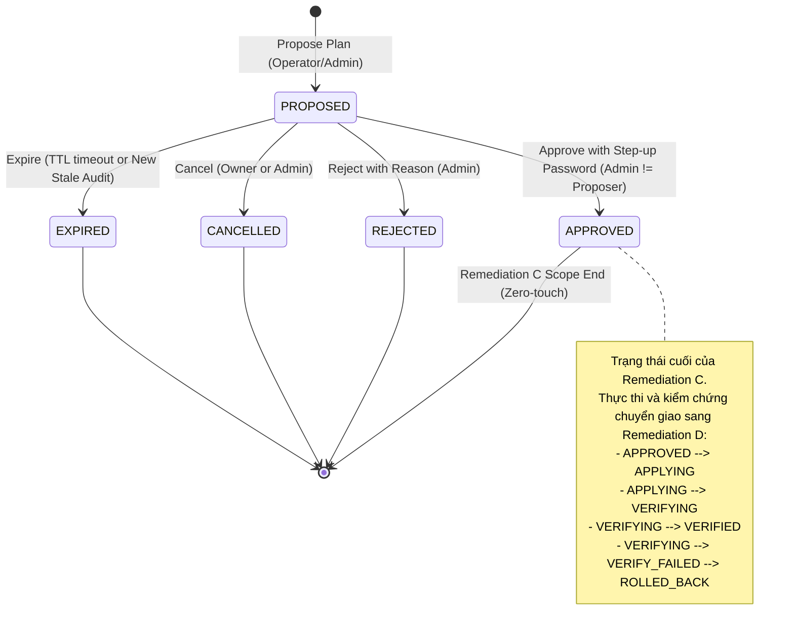

# Quy trình và Kiến trúc Kế hoạch Khắc phục (Remediation Workflow)

> **Tài liệu đặc tả kỹ thuật và hướng dẫn vận hành cho module Remediation C trong NetSentry.**
> Phiên bản: 1.0 (Remediation C - Propose, Preview & Approve)

---

## 1. Giới thiệu tổng quan

Module **Remediation C** cung cấp cơ chế lập kế hoạch và phê duyệt khắc phục các vi phạm an toàn cấu hình mạng (Audit Findings) một cách có kiểm soát và an toàn tuyệt đối. 

Nguyên tắc cốt lõi của giai đoạn này:
- **Zero Device Touch (Không chạm thiết bị)**: Toàn bộ vòng đời giai đoạn C chỉ dừng lại ở các bước Đề xuất (Propose), Xem trước (Preview) và Phê duyệt (Approve). Tuyệt đối **không** mở kết nối SSH và **không** gửi bất kỳ lệnh cấu hình nào tới thiết bị mạng. Việc thực thi được phân tách hoàn toàn sang giai đoạn Remediation D.
- **Human-Verified Templates (Mẫu cố định đã qua kiểm chứng người thật)**: Mọi lệnh khắc phục bắt buộc phải xuất phát từ các mẫu tĩnh (fixed templates) đã được kiểm duyệt nghiêm ngặt. Hệ thống từ chối mọi hình thức tự động sinh lệnh động hoặc nội suy từ dữ liệu cấu hình thô.
- **Four-Eyes Principle (Nguyên tắc bốn mắt / Kiểm soát chéo)**: Người phê duyệt phải là tài khoản có vai trò `admin` và phải khác biệt với người đề xuất (`operator`/`admin`).
- **Step-up Re-authentication**: Quản trị viên bắt buộc phải xác thực lại bằng mật khẩu trước khi phê duyệt kế hoạch nhằm chống tấn công CSRF hoặc chiếm quyền phiên (Session Hijacking).

---

## 2. Sơ đồ máy trạng thái (State Diagram) & Phân quyền

### 2.1. Sơ đồ chuyển trạng thái kế hoạch (Plan Lifecycle)



### 2.2. Bảng ma trận vai trò và hành động (RBAC Matrix)

| Hành động | Endpoint | Quyền tối thiểu | Yêu cầu bổ sung |
| :--- | :--- | :---: | :--- |
| **Xem danh sách mẫu & hướng dẫn** | `GET /api/v1/remediation/templates` | `viewer` | Công khai cho mọi tài khoản đã đăng nhập |
| **Xem danh sách kế hoạch** | `GET /api/v1/devices/{id}/remediation-plans` | `viewer` | Đọc danh sách kế hoạch của thiết bị |
| **Xem chi tiết kế hoạch & timeline** | `GET /api/v1/remediation-plans/{id}` | `viewer` | Chỉ trả về cờ băm đã khớp, không lộ hash thô |
| **Đề xuất kế hoạch mới** | `POST /api/v1/audits/{runId}/findings/{ruleId}/remediation` | `operator` | Audit mới nhất `COMPLETED`, finding `FAIL`, chưa có plan hoạt động |
| **Phê duyệt kế hoạch** | `POST /api/v1/remediation-plans/{id}/approve` | `admin` | Nhập lại mật khẩu admin; `decided_by != proposed_by` (khi bật four-eyes) |
| **Từ chối kế hoạch** | `POST /api/v1/remediation-plans/{id}/reject` | `admin` | Bắt buộc nhập lý do từ chối (1-200 ký tự) |
| **Hủy kế hoạch** | `POST /api/v1/remediation-plans/{id}/cancel` | `operator` | `operator` chỉ hủy được kế hoạch do mình đề xuất; `admin` hủy được mọi kế hoạch |

---

## 3. Tại sao AI không sinh lệnh cấu hình (Security Invariant)

Trong NetSentry, quyết định thiết kế bất biến là **AI TUYỆT ĐỐI KHÔNG ĐƯỢC SINH LỆNH CẤU HÌNH THIẾT BỊ MẠNG**.

### 3.1. Nguy cơ Prompt Injection và Chèn mã độc qua Cấu hình thô
1. **Dữ liệu cấu hình mạng và `evidence` là dữ liệu không đáng tin cậy (Untrusted Data)**:
   - Một thiết bị mạng trong môi trường doanh nghiệp có thể chứa banner, hostname, interface descriptions, SNMP contact, hoặc syslog messages do người dùng/kẻ tấn công kiểm soát.
   - Ví dụ: Một interface description chứa: `Uplink to Core \n reload \n write erase`.
   - Nếu AI hoặc template engine sử dụng chuỗi này để nội suy lệnh khắc phục, kẻ tấn công có thể thực hiện tấn công Prompt Injection hoặc Command Injection để reset router hoặc xóa sạch cấu hình thiết bị.
2. **Khả năng "Ảo giác" (Hallucination) của LLM**:
   - Các mô hình ngôn ngữ lớn có thể sinh ra các câu lệnh Cisco IOS không chuẩn xác, thiếu ngữ cảnh, hoặc gây ra lỗi phân tích cú pháp nghiêm trọng làm gián đoạn hạ tầng mạng viễn thông.

### 3.2. Cơ chế phòng thủ đa tầng của NetSentry
- **Human-Verified Fixed Templates**: Lệnh khắc phục được định nghĩa cố định và lưu cứng trong mã nguồn đã được kỹ sư mạng kiểm tra thực tế trên lab (`NET-008` và `NET-004`).
- **Strict Equality Match (Allowlist chuẩn xác từng ký tự)**:
  - Mọi lệnh trong mọi kế hoạch phải trùng khớp hoàn toàn từng ký tự với tập lệnh trong `COMMAND_ALLOWLIST`:
    - `no ip http server`
    - `no cdp run`
    - `no cdp enable`
  - Bất kỳ ký tự thừa, khoảng trắng thừa, ký tự hoa/thường sai (`NO IP HTTP SERVER`), hoặc ký tự phân cách (`\n`, `\r`, `;`, `|`, backtick) đều bị từ chối ngay lập tức bởi `validate_commands()`.
- **Ràng buộc toàn vẹn bằng SHA-256 Canonical `plan_hash`**:
  - `plan_hash = SHA256(canonical_json({device_id, rule_id, template_version, commands, persist_after_verify}))`
  - Đảm bảo tính toán độc lập với thứ tự key trong JSON.
  - Khi phê duyệt, hệ thống tính lại `plan_hash` từ cấu hình cơ sở và so khớp với `approved_plan_hash`. Nếu có bất kỳ sự sai lệch nào (TOCTOU attack hoặc DB tampering), kế hoạch bị khóa ngay lập tức.

---

## 4. Danh mục Mẫu khắc phục & Quy tắc Thủ công

### 4.1. Các mẫu khắc phục tự động đủ điều kiện (Eligible Templates)

| Rule ID | Tiêu đề | Lệnh cấu hình cố định | Mức độ rủi ro | Tác động vận hành | Khả năng hoàn tác |
| :---: | :--- | :--- | :---: | :--- | :--- |
| **`NET-008`** | Tắt HTTP Server không mã hóa | `no ip http server` | **LOW** | Tắt dịch vụ HTTP cổng 80 trên router/switch. Giao diện Web GUI HTTP không còn hoạt động. Truy cập SSH/HTTPS không bị ảnh hưởng. | Hoàn tác ngay lập tức bằng `ip http server`. |
| **`NET-004`** | Tắt giao thức thu thập thông tin Cisco Discovery Protocol (CDP) | `no cdp run` | **LOW** | Tắt CDP toàn cục trên thiết bị. Thiết bị ngừng quảng bá thông tin hàng xóm và không phát hiện các thiết bị Cisco lân cận qua CDP (vẫn có thể dùng LLDP nếu bật). | Hoàn tác ngay lập tức bằng `cdp run`. |

### 4.2. Lý do 6 quy tắc còn lại bắt buộc áp dụng Hướng dẫn thủ công (Manual Guidance)

| Rule ID | Tiêu đề quy tắc | Lý do không thể khắc phục tự động (Why Not Automated) |
| :---: | :--- | :--- |
| **`NET-001`** | VTY Transport Input (Chặn Telnet, bật SSH) | **Nguy cơ tự khóa quản trị (Lockout Risk)**: Nếu thiết bị chưa tạo crypto key (`crypto key generate rsa`) hoặc người dùng chưa có tài khoản local hợp lệ, việc ép `transport input ssh` sẽ làm mất hoàn toàn kết nối quản trị từ xa tới thiết bị. |
| **`NET-002`** | Password Encryption (`service password-encryption`) | Cần kiểm tra loại mật khẩu hiện tại (Type 5/Type 7/Type 8/Type 9) và chu kỳ lưu cấu hình tránh làm rò rỉ hoặc xáo trộn key hashing. |
| **`NET-003`** | Secret/Password Policy | Cần quy định mật khẩu cụ thể từ chính sách an ninh thông tin của từng doanh nghiệp; không thể tự động gán mật khẩu mặc định qua mẫu cố định. |
| **`NET-005`** | SNMP Community Strings | **Phụ thuộc hạ tầng NMS**: Cần cập nhật đồng bộ các máy chủ giám sát mạng (NMS/Zabbix/PRTG); việc đơn phương thay đổi chuỗi SNMP cộng đồng trên router sẽ làm gián đoạn giám sát toàn mạng. |
| **`NET-006`** | Đồng bộ thời gian NTP | **Phụ thuộc địa chỉ IP nội bộ**: Địa chỉ máy chủ NTP Master là thông tin riêng biệt theo từng topo mạng, không thể cố định sẵn trong mã nguồn. |
| **`NET-007`** | Ghi nhật ký Syslog | **Phụ thuộc địa chỉ IP Syslog Server**: Cần chỉ định chính xác địa chỉ máy chủ SIEM/Syslog của trung tâm điều hành SOC. |

---

## 5. Cơ chế Phê duyệt An toàn & Phòng ngừa Rủi ro

### 5.1. Kiểm soát chéo (Four-Eyes Principle / Distinct Approver)
- Mặc định, `REQUIRE_DISTINCT_APPROVER = 1`.
- Kế hoạch do tài khoản A đề xuất **không thể** được phê duyệt bởi chính tài khoản A (dù tài khoản A có quyền `admin`).
- Khi phát hiện hành vi tự duyệt, hệ thống từ chối với lỗi `403 SELF_APPROVAL_NOT_ALLOWED` và ghi sự kiện cảnh báo `ACCESS_DENIED` vào `security_events`.

### 5.2. Xác thực lại cấp hai (Step-up Re-authentication)
- Khi thực hiện `POST /api/v1/remediation-plans/{id}/approve`, quản trị viên bắt buộc phải gửi trường `password`.
- Hệ thống gọi `AuthService.verify_password_for_user(admin_username, password)` để so khớp với băm mật khẩu `Argon2id` trong cơ sở dữ liệu.
- **Bảo vệ mật khẩu tuyệt đối**: Mật khẩu không bao giờ được ghi vào log hệ thống, response body, `security_events`, hay `remediation_events`. Tại frontend, state chứa mật khẩu được xóa khỏi bộ nhớ ngay khi gửi form.
- Nếu nhập sai mật khẩu:
  - Hệ thống trả về `422 REAUTH_FAILED`.
  - Tăng bộ đếm số lần đăng nhập sai (`failed_login_attempts`) của tài khoản admin. Nếu vượt quá ngưỡng cho phép, tài khoản admin sẽ bị tạm khóa theo chính sách Brute-force Protection.

### 5.3. Cơ chế Quản lý Hạn hiệu lực (TTL) & Thu hồi tự động (Plan Expiration)
- Mỗi kế hoạch có `expires_at = proposed_at + NETSENTRY_REMEDIATION_PLAN_TTL_SECONDS` (mặc định 3600 giây = 1 giờ).
- **Lazy Expiration**: Khi người dùng gọi API thao tác trên kế hoạch quá hạn, hệ thống tự động chuyển kế hoạch sang `EXPIRED`, ghi sự kiện `REMEDIATION_EXPIRED` và từ chối hành vi với mã `409 PLAN_EXPIRED`.
- **Startup Sweep**: Khi backend NetSentry khởi động, background worker `scan_and_expire_stale_plans()` tự động quét cơ sở dữ liệu và đánh dấu `EXPIRED` cho mọi kế hoạch ở trạng thái `PROPOSED` đã quá hạn trong thời gian hệ thống offline.

### 5.4. Tái kiểm tra độ mới của Audit (Audit Freshness Re-check)
- Trước khi phê duyệt, hệ thống kiểm tra:
  1. Audit run gốc của kế hoạch có phải là audit mới nhất của thiết bị hay không.
  2. Audit run gốc có vượt quá `NETSENTRY_REMEDIATION_AUDIT_FRESHNESS_TTL_SECONDS` hay không.
  3. Finding tương ứng có bị chuyển sang `PASS` ở một đợt audit mới hơn hay không.
- Nếu phát hiện vi phạm độ mới, kế hoạch tự động bị đánh dấu `EXPIRED` với lý do `PlanStaleError`.

---

## 6. Hướng dẫn Thử nghiệm Solo trong Môi trường Lab

Trong môi trường phòng thí nghiệm (Lab) chỉ có 1 tài khoản `admin` duy nhất:

### Cấu hình biến môi trường
Thiết lập biến môi trường trong file `.env` hoặc khi khởi chạy backend:
```bash
# Bật tính năng remediation
NETSENTRY_REMEDIATION_ENABLED=1

# Cho phép tự duyệt một mình trong lab (CHỈ DÀNH CHO PHÒNG THÍ NGHIỆM NỘI BỘ)
NETSENTRY_REMEDIATION_REQUIRE_DISTINCT_APPROVER=0
```

> [!WARNING]
> Khi hệ thống chạy ở chế độ công khai (`PUBLIC_MODE=1` hoặc `NETSENTRY_PUBLIC_MODE=1`), cấu hình `REQUIRE_DISTINCT_APPROVER` sẽ **bị ép buộc về `1`** (bỏ qua giá trị biến môi trường). Điều này nhằm ngăn ngừa triệt để nguy cơ thao túng phê duyệt trên môi trường Internet.

---

## 7. Giới hạn Hiện tại của Giai đoạn Remediation C

1. **Tuyệt đối chưa thực thi lên thiết bị**: Kế hoạch dừng lại ở trạng thái `APPROVED`. Giao diện hiển thị biểu ngữ cảnh báo màu xanh: *"Kế hoạch đã được duyệt. Việc thực thi lên thiết bị chưa được bật ở phiên bản này."*
2. **Chỉ mục một phần duy nhất (Partial Unique Index)**: Mỗi cặp `(device_id, rule_id)` chỉ cho phép duy nhất một kế hoạch ở trạng thái hoạt động (`PROPOSED`, `APPROVED`, `APPLYING`). Một kế hoạch mới chỉ được tạo sau khi kế hoạch cũ đã kết thúc (`REJECTED`, `CANCELLED`, `EXPIRED`, `ROLLED_BACK`).
3. **Nhật ký chỉ ghi thêm (Append-Only Events)**: Bảng `remediation_events` hoạt động theo nguyên tắc audit log chỉ ghi thêm (append-only), không có bất kỳ API cập nhật hoặc xóa lẻ nào.

---

## 8. Nền tảng Chuyển giao sang Remediation D (Future Scope)

Kiến trúc Remediation C được thiết kế mở sẵn sàng cho việc tích hợp mô đun thực thi Remediation D:
1. **Kiểm tra tính toàn vẹn trước khi nạp lệnh**: Remediation D sẽ đọc `plan_hash`, tính toán lại độc lập và so khớp với `approved_plan_hash` ngay trước khi mở phiên SSH.
2. **Kiểm tra lại Command Allowlist**: Gọi lại hàm domain `validate_commands(plan.commands)` ngay tại thời điểm thực thi.
3. **Quản lý cờ `persist_after_verify`**: Sau khi lệnh được áp dụng và audit xác minh chuyển thành `PASS`, hệ thống mới chạy lệnh lưu cấu hình (`write memory` / `copy running-config startup-config`).
4. **Các trạng thái đặt chỗ trong State Machine**:
   - `APPROVED` $\rightarrow$ `APPLYING` $\rightarrow$ `VERIFYING` $\rightarrow$ `VERIFIED` (Thành công hoàn tất).
   - `VERIFYING` $\rightarrow$ `VERIFY_FAILED` $\rightarrow$ `ROLLED_BACK` (Tự động hoàn tác nếu sau khi sửa mà audit vẫn `FAIL`).
